🇬🇧 English · [🇳🇱 Nederlands](README.md)

# HB Inventaris

Self-hosted inventory management app for electronic components. Flask +
SQLite backend, single-page frontend that works on PC, tablet and phone.

Made by [huizebruin.nl](https://huizebruin.nl).

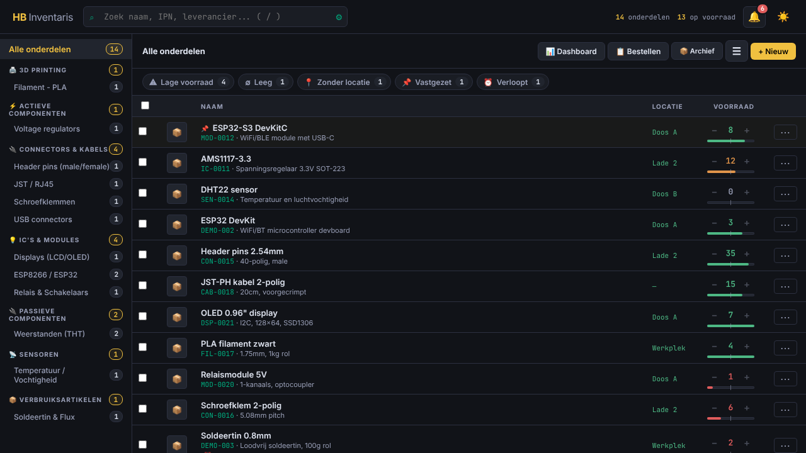

## ⚠️ Note: for LAN use only

By default this app has **no login**. Anyone who can reach the port can read, change and delete all data.
So **never expose it directly to the internet** (no port forward to port 5000).

- Inside your own network: optionally set `HB_AUTH_USER` and `HB_AUTH_PASSWORD` in `.env` to enable a login.
- From outside: use a VPN, or a reverse proxy with **HTTPS** and a login.
- Step-by-step guide, checklist, nginx/Caddy examples and firewall rules: **[docs/DEPLOYMENT.en.md](docs/DEPLOYMENT.en.md)**.

There are two ways to run the app: via **Docker** (recommended for a
NAS/server), or **directly on Windows** without Docker.

---

## The main screen

The main screen is designed to stay calm, even with a large inventory.
Everything you need day to day is visible at a glance; the rest is one tap
away.

### List with stock in the row

- **Three columns by default:** name, location and stock. The IPN is shown as
  a small line under the name. Extra columns (IPN, category, price,
  modified) can be switched on via *Menu → Settings → Set columns*, where
  you'll also find **Compact rows** and a button to restore the default
  view. A previously saved column selection stays in effect.
- **Adjust stock directly:** with **−** and **+** in the row itself (also in
  the cards on a phone), or click the number to type an exact quantity.
  Every change is recorded in the history as a transaction.
- **Status bar under the number:** shows how far above or below the
  configured minimum you are. The tick in the middle is the minimum. Red is
  below the minimum, orange up to 1.5× the minimum, green above that. Parts
  without a minimum get no bar.
- **Actions behind ⋯:** pin, open link, edit and delete
  (delete is separate at the bottom, in red).

### Quick filters

Below the toolbar are chips with a counter: **Low stock**, **Empty**,
**No location**, **Pinned** and **Expires**. You can combine chips with each other and with the search bar or a category; **✕ Clear filters** resets everything.
Chips without results are not shown, so the bar stays empty when
there is nothing to worry about.

<table>
  <tr>
    <td width="50%">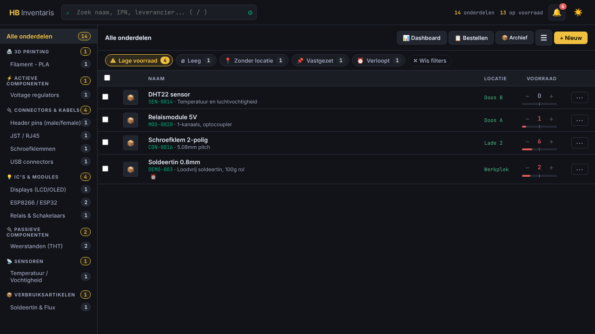</td>
    <td width="50%">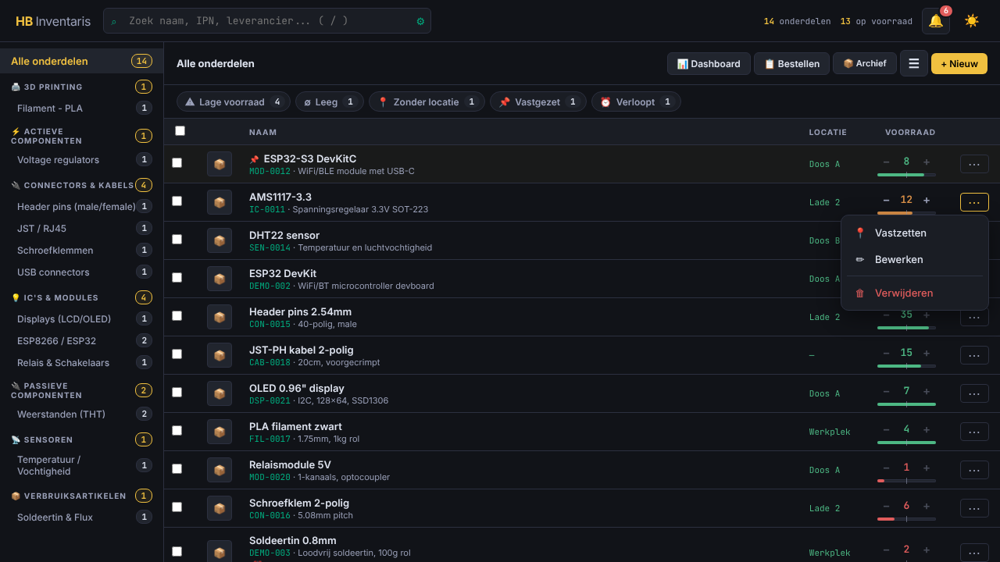</td>
  </tr>
  <tr>
    <td align="center"><sub>Filter <b>Low stock</b> active</sub></td>
    <td align="center"><sub>Actions per row behind <b>⋯</b></sub></td>
  </tr>
</table>

### Multiple parts at once

Tick parts and a bar appears with the three most-used
actions: **Location**, **Category** and **Stock**. Everything needed less often
(adding/removing tags, printing labels, archiving and
deleting) is under **⋯ More**.

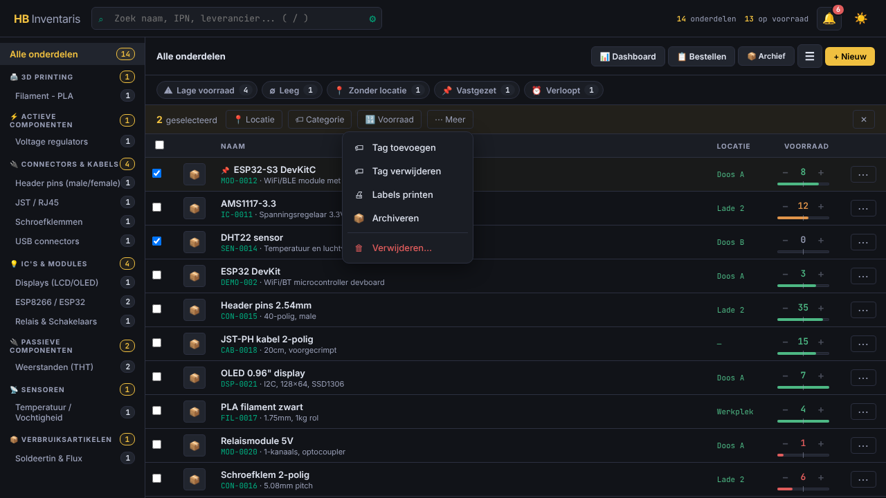

## Notifications and menu

**Notifications:** the separate badges in the header have been replaced by a single bell with
a counter. Tap it to see Low stock, Expiring soon and
Suggestions, each with a count, plus a shortcut to
show empty compartments. Clicking a line turns on the corresponding filter.

**Menu:** all options are still reachable, but now sit in collapsible groups:
*Admin*, *Print & export*, *Data* and *Settings* (on phone also
*Overviews*). At the top is a search field ("export" immediately finds *Export*
and *Excel export*) and the menu remembers which group you had open last.

<table>
  <tr>
    <td width="50%">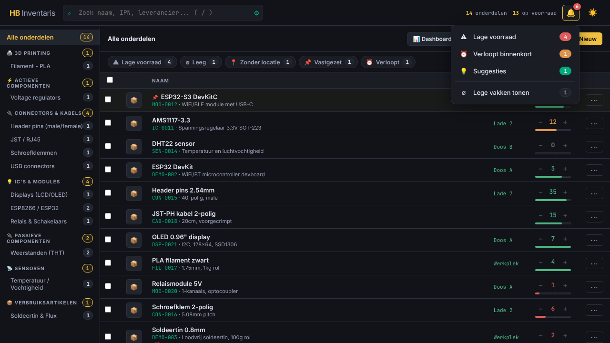</td>
    <td width="50%">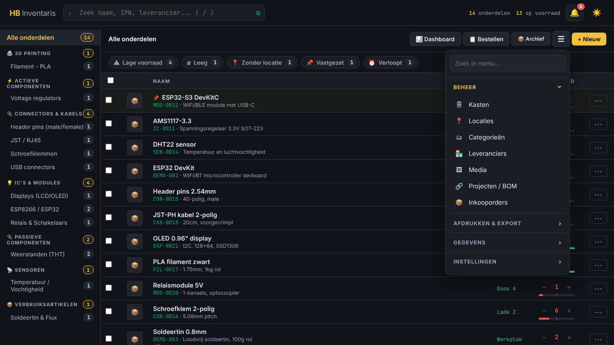</td>
  </tr>
  <tr>
    <td align="center"><sub>Notifications under the bell</sub></td>
    <td align="center"><sub>Menu with groups and search field</sub></td>
  </tr>
</table>

## On phone and tablet

The interface adapts to the screen.

- **Phone (up to 640 px):** the list becomes a list of cards with
  **−/+** on the right and the status bar below. At the bottom is a navigation bar
  with *Categories*, *Add*, *Locations* and *Menu*. Categories slide out
  as a panel, the menu opens as a sheet at the bottom, and a part opens
  full screen. It accounts for the notch and the home indicator, and
  input fields are large enough that iOS doesn't zoom in.
- **Tablet (641–1024 px):** the sidebar stays visible and the detail panel
  slides over the list instead of squeezing the table.
- **Install as an app:** open the site in your phone's browser and choose
  *Add to Home Screen*. The app then opens without a browser bar. There is no
  offline mode: the app and your inventory always come from your own server,
  so you need a connection to your network.

<table>
  <tr>
    <td width="33%">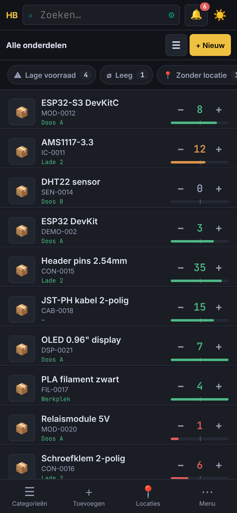</td>
    <td width="33%">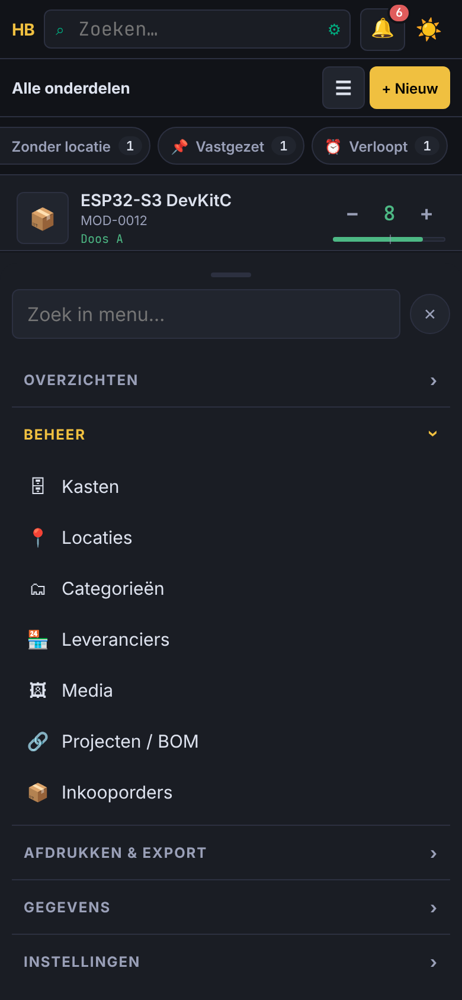</td>
    <td width="33%">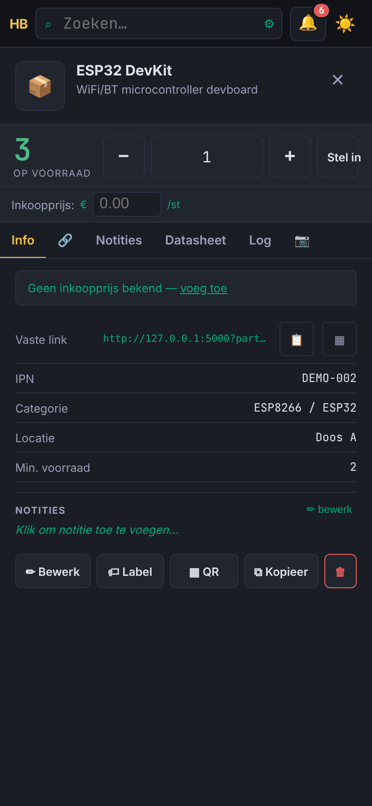</td>
  </tr>
  <tr>
    <td align="center"><sub>List</sub></td>
    <td align="center"><sub>Menu</sub></td>
    <td align="center"><sub>Detail</sub></td>
  </tr>
  <tr>
    <td width="33%">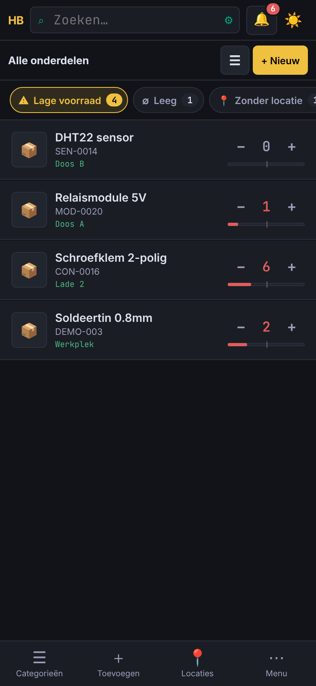</td>
    <td width="33%">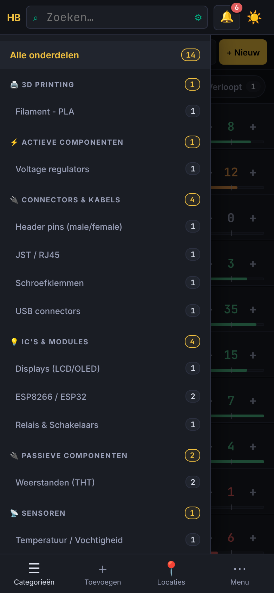</td>
    <td width="33%">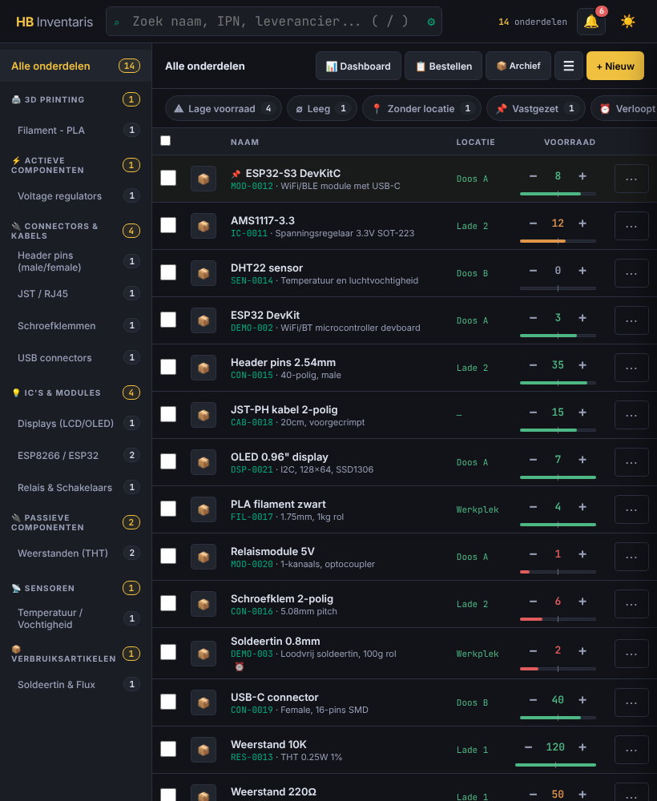</td>
  </tr>
  <tr>
    <td align="center"><sub>Quick filter</sub></td>
    <td align="center"><sub>Categories</sub></td>
    <td align="center"><sub>Tablet</sub></td>
  </tr>
</table>

<details>
<summary>Light theme</summary>

You can switch between dark and light with the sun/moon at the top right of the header.
Your choice is remembered in your browser.

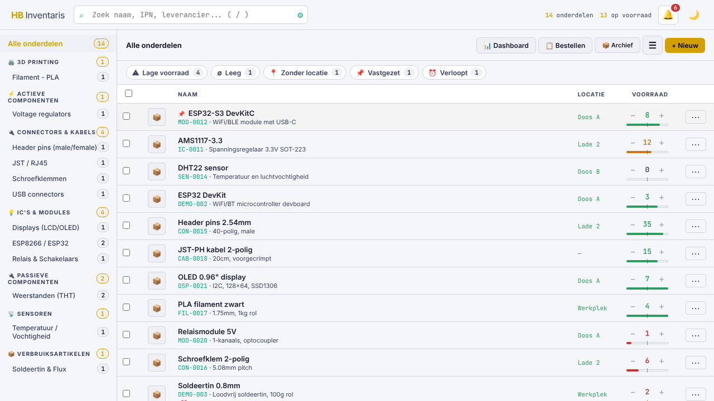

</details>

## Taal / Language

The app is available in **Dutch and English**: *Menu → Settings → Language / Taal*. Without a choice it follows your browser.
Emails follow `HB_LANG` in `.env`. The dictionary is in `static/i18n-en.js`; if a text is missing, it stays Dutch.
Adding a new text in the code? Write it in Dutch and put the translation in that file (`"Nederlandse tekst": "English text"`, with `{0}`, `{1}` for variable parts).

## Tests and development

```bash
pip install -r requirements-dev.txt
python -m pytest      # tests (use a temporary database, don't touch your data)
ruff check .          # lint
```

GitHub Actions runs this on every push. Changes are listed in [CHANGELOG.en.md](CHANGELOG.en.md); you make a release by pushing a tag
(e.g. `3.9.0`, equal to `APP_VERSION` in `server.py`).

## Administration, backups and import/export

Under **Menu → Admin → Admin & health** you'll find a dashboard with database size, disk space, last/next backup and
integrity status, a check with repair actions, backups (with retention and restore with verification), import/export
(CSV, Excel, JSON with a preview before saving), media cleanup and the log. See [docs/ADMIN.en.md](docs/ADMIN.en.md).
New optional settings are in `.env.example`.

## Keyboard shortcuts

Shortcuts work as long as you're not typing in an input field. You can also find an overview
in the app under **?** (*Help & shortcuts*).

| Key | Action |
| --- | --- |
| `/` | Activate search bar |
| `N` | New part |
| `F2` | Scanner |
| `Z` | Show/hide empty compartments |
| `R` | Reorder suggestion |
| `B` | Order list |
| `D` | Dashboard |
| `E` | Export |
| `H` | History |
| `K` / `M` / `P` / `I` | Cabinets / Media / Projects / Purchase orders |
| `?` | Help |
| `Esc` | Close |

With a part open: `F` edit, `↑` or `+` stock +1, `↓` or `-`
stock −1, `L` log, `C` copy.

---

## Option A: Run via Docker

1. Make sure Docker and docker-compose are installed.
2. Copy `.env.example` to `.env` and fill in your own keys if needed:
   ```bash
   cp .env.example .env
   ```
   - `GEMINI_API_KEY` / `GEMINI_MODEL` — for AI features (spec lookup,
     category suggestions, duplicate detection, photo recognition). Leave empty
     to disable these features.
   - `TELEGRAM_BOT_TOKEN` / `TELEGRAM_CHAT_ID` — for build notifications via
     Telegram. Leave empty to disable.
3. Start the app:
   ```bash
   docker-compose up -d
   ```
4. The app runs internally on port **5000** (Flask). In `docker-compose.yml`
   this is mapped to a port on your NAS/server via the `ports:` line
   (e.g. `5000:5000`). You then reach the app at
   `http://<NAS-ip-or-hostname>:5000`, or via your nginx reverse proxy if you
   have set one up.
5. On first start an empty database is created, with a small
   set of example locations, categories and demo parts so you can see right away
   how everything works.

### Restarting after changes

- Only code changed (e.g. `server.py`, `app.html`): `docker restart <containername>`
- `.env` changed (new API keys etc.): `docker-compose up -d` (not just
  restart, otherwise the new env vars won't be loaded)

---

## Option B: Run on Windows, without Docker

The app can also run standalone on a Windows PC, with no technical
knowledge required.

1. **Put all files in one folder** — `server.py`, the `static/` folder (with
   `app.html`, `app.css`, `fonts/`) and `Start HB Inventaris.bat` together in,
   for example, a folder on your Desktop.
2. **Double-click `Start HB Inventaris.bat`.** If Python isn't installed on the
   PC yet, the download page opens automatically — install it like any
   other program (Next, Next, Finish), and during
   installation tick the checkbox **"Add python.exe to PATH"**.
3. **Then double-click again** on `Start HB Inventaris.bat`. The first
   time, the script installs the required components (Flask) itself — you'll
   see that flash by, there's nothing you need to do.
4. **The browser opens by itself** with the app in it, after a few seconds.
5. **Next time:** just double-click the same
   bat file again. Everything is already set up, so it's quick right away.

Just leave the "HB Inventaris" window that opens open as long as you're using the
app — closing it stops the app.

---

## Data

All personal data (database, photos, backups) lives in a folder called
`data/` (and `media/`, `backups/`) next to `server.py`, and is **not**
included in this repository. This is intentional: you start with a clean
inventory plus a small demo set.

With Docker these are mounted volumes; when running standalone on
Windows the app simply creates these folders itself next to `server.py`.

## Structure

- `server.py` — Flask backend + SQLite (WAL mode)
- `static/app.html` — complete frontend (single-page app)
- `static/app.css` — styling
- `static/fonts/` — locally embedded fonts (no CDN dependency, works
  offline)
- `docs/screenshots/` — screenshots for this README
- `docker-compose.yml`, `Dockerfile` — deployment (Docker)
- `Start HB Inventaris.bat` — start script (Windows, without Docker)
- `requirements.txt` — Python dependencies (`pip install -r requirements.txt`)

The screenshots were made with demo parts; no real
inventory is shown.

## License

MIT license with an attribution requirement — see [LICENSE](./LICENSE).
Every publicly accessible deployment of this software (modified or not)
must keep a visible "Made by huizebruin.nl" notice somewhere in the app, with
a link to https://huizebruin.nl (e.g. on an "About" screen or in
the footer).
